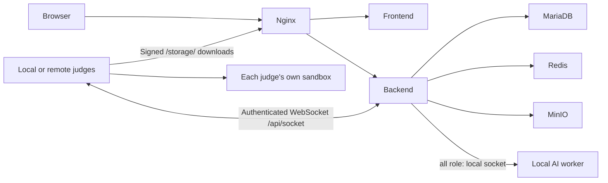

# Distributed judging

[简体中文](Distributed-Judging.zh-CN.md) | English | [Wiki home](Home.en.md)

A site can judge on its own server, on separate judge servers, or both.

- **`all` site plus remote judges:** the site keeps its own judge and the local AI worker, and remote judges share ordinary judging. Choose this if you use AI to check reference solutions or generate test data.
- **`web` site plus remote judges:** the site does no judging and doesn't build a sandbox; remote judges do all judging. AI checks and data generation aren't available (see [AI](#ai)).



Judges connect to the site, so they need no open incoming port. They have no database, Redis or MinIO credentials: they receive tasks from the backend, download and cache test data through signed links, and send back results. There is one backend and one database; this isn't a high-availability cluster.

## Setting up the site

For a site that only serves the web:

```bash
sudo bash /tmp/llmoj-install.sh --repository houyhlouis/LLMOJ \
  --role web --public-url http://oj.example.com
```

Judges send their key when they connect, so set up [HTTPS](HTTPS.md) before connecting judges over the internet, or use a private network you control.

The installer already sets up WebSocket connections on `/api/socket` and points judge downloads (`services.minio.forJudge.urlEndpoint`) at `/storage/` on the public address. The database and MinIO stay reachable only from the site's server.

## Adding a judge

1. As a site administrator, open **Judge Machine** (`/judge-machine`), click **Add**, enter a name such as `judge-01` and confirm.
2. Click the key icon in the new judge's row to show its key, and save it in the judge server's private key file. Don't paste it anywhere else.
3. Set up the judge server as described in [Remote judges](Remote-Judge.md), with the same version and sandbox image recipe as the site.
4. When the judge's log shows "Successfully authorized as …", its row on **Judge Machine** shows **Online**.
5. Submit a simple C++ program and check that it's downloaded, compiled, run and Accepted. Also try a compile error, a time limit, a memory limit and cancelling, on each judge.

Register every judge separately with its own key: when a second connection uses the same key, it replaces the first. The `allowedHosts` field of a judge isn't checked when it connects; to restrict where judges may connect from, use a firewall, VPN or reverse proxy.

## The judge queue

Judge tasks are stored in the database (table `judge_job`), not only in Redis: a submission, hack or Self Eval run is saved together with its task, so restarting the backend or Redis loses no queued work. Redis only wakes up waiting judges, which also check for tasks every few seconds.

- Each task goes to one judge connection at a time, under a lease that the backend renews while the judge stays connected. The result is saved together with finishing the task, and a result from an older lease (for example from before a reconnect) is ignored.
- When a judge disconnects, its unfinished tasks are queued again at once. When the backend itself stops, its leases expire after 90 seconds, and another backend process, or the restarted one, queues them again. So a task may be judged more than once, but its result counts once.
- A task is given up after 5 interruptions, or after 10 failures to prepare it (for example because test data is missing). Its submission then shows **System Error** with the reason, and can be rejudged.
- Site administrators see the queue at the bottom of **Judge Machine**: tasks waiting or being judged, the judge holding each, retries, and the tasks given up in the last 7 days. The `libreoj_judge_jobs` metric reports waiting and running tasks.
- Every lease is recorded in `judge_job_attempt` with how it ended. Finished tasks and their records are deleted after 30 days.

## Draining, keys and capabilities

These actions are on the **Judge Machine** page for site administrators. Every change is recorded in the audit log (`judge_client.add`, `delete`, `reset_key`, `drain`, `resume`).

- **Drain** (pause icon) stops sending new tasks to a judge; it finishes those it has. Its status shows **Draining** while it's still judging, then **Drained**: you can now stop, upgrade or resize it without interrupting judging, while the other judges take the queue. It stays drained after reconnecting, or after the backend restarts, until you **Resume** it (play icon). Draining doesn't affect local AI checks, which don't use the queue.
- **Reset key** and **Delete** take effect at once: the judge is disconnected from every backend process, and its unfinished tasks are queued again for other judges. Reset a key that may have leaked, then put the new key on the judge server.
- **Capacity:** when a judge connects, it reports its protocol version, the task types it can run, its task threads, judge slots, slots for AI checks and memory budget, shown in the **Capacity** column. The backend sends it only the task types it reported. An older judge reports nothing and is marked **Legacy**: it receives only submissions, so hacks and Self Eval runs wait until an updated judge is online.
- **Runtime:** a judge of protocol version 3 also reports its judge program (a digest of its source files), its sandbox image and its Node.js version, shown with its capacity. Each result records them, with the judge machine ([What judged a result](Submissions.md#what-judged-a-result)). When online judges report different judge programs or sandbox images, the page warns that a submission may get a different result depending on which one judges it: update them to the same version. Judges of protocol version 3 also check test data against its [content hashes](Submissions.md#content-hashes); older ones still judge, without either.

To change a judge's number of slots, see [Judge configuration](Judge-Configuration.md#changing-the-number-of-slots). Work on one judge at a time, and check it before moving on to the next.

## AI

AI features that only call a model, such as editing, translation and search, work in every layout. Checking AI reference solutions and generating test data, however, run on the site's own server through a local socket and private directories; there's no way yet to run them on a remote judge. Remote judges don't take over this work, and adding remote judge slots doesn't give the AI worker more capacity. These features need the `all` role and aren't available on a `web` site. Don't replace the local socket with an open TCP port or a shared directory.

## Troubleshooting

- **A judge can't connect:** check the site's address, HTTPS, WebSocket forwarding of `/api/socket`, and the judge's key.
- **A judge is online but downloads fail:** check whether the download links point to `127.0.0.1`, port 19000 or an address the judge can't reach, and check how `/storage/` is forwarded.
- **Judges keep disconnecting each other:** two of them share a key.
- **cgroup errors:** check systemd delegation, cgroup v2 and the kernel.
- **AI checks fail although remote judges are online:** the site needs the `all` role and its local worker.
- **Hacks or Self Eval runs keep waiting:** check that an online judge that isn't drained runs the current version (not **Legacy**) and lists them under **Capacity**.
- **A judge gets no tasks:** check whether it's drained, and resume it.
- **A submission fails with "doesn't match its recorded content":** the stored file changed after it was accepted (in object storage, or by a second upload with the same upload form). Upload the file again and rejudge. If it happens for many files, check the object storage's disk.
