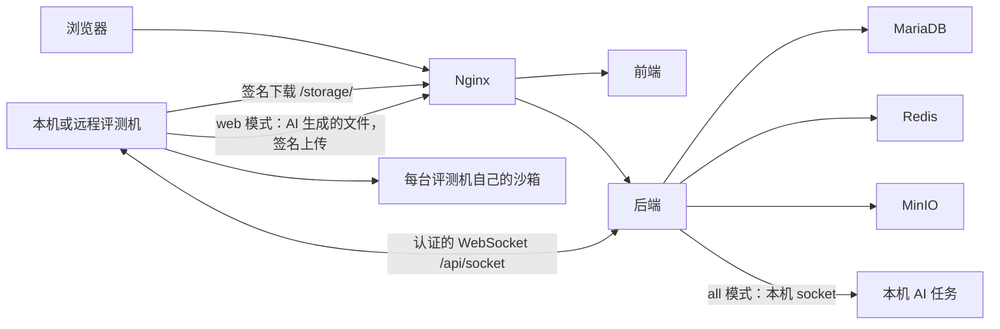

# 分布式评测

简体中文 | [English](Distributed-Judging.md) | [Wiki 首页](Home.md)

站点可以在自己的服务器上评测，也可以使用独立的评测服务器，或两者同时使用。

- **`all` 站点加远程评测机：** 站点保留自己的评测机和本机 AI 任务，远程评测机分担普通评测。AI 程序在站点自己的评测机上运行。
- **`web` 站点加远程评测机：** 站点不评测，也不构建沙箱；所有评测都由远程评测机完成，AI 程序也由它们运行（见 [AI](#ai)）。



评测机主动连接站点，因此不需要开放入站端口。它们没有数据库、Redis 或 MinIO 的凭据：从后端接收任务，通过签名链接下载并缓存测试数据，然后回传结果。站点只有一个后端和一个数据库，并不是高可用集群。

## 设置站点

仅提供网页的站点：

```bash
sudo bash /tmp/llmoj-install.zh-CN.sh --repository houyhlouis/LLMOJ \
  --role web --public-url http://oj.example.com
```

评测机连接时会发送密钥，因此通过公网连接评测机之前，请先配置 [HTTPS](HTTPS.zh-CN.md)，或使用你能控制的内网。

安装器已经为 `/api/socket` 配置了 WebSocket 连接，并把评测机的下载地址（`services.minio.forJudge.urlEndpoint`）设为公开地址下的 `/storage/`。数据库和 MinIO 仍然只能从站点服务器本机访问。

## 添加评测机

1. 以站点管理员身份打开 **评测机状态**（`/judge-machine`），点击 **添加**，输入名称（例如 `judge-01`）并确认。
2. 点击新评测机所在行的钥匙图标显示其密钥，把它保存到评测服务器的私有密钥文件中。不要把它粘贴到其他地方。
3. 按[远程评测机](Remote-Judge.zh-CN.md)设置评测服务器，使用与站点相同的版本和沙箱镜像配方。
4. 评测机日志显示“Successfully authorized as …”后，它在 **评测机状态** 页面的状态会变为 **在线**。
5. 提交一个简单的 C++ 程序，确认它被下载、编译、运行并得到 Accepted。还要在每台评测机上测试编译错误、超时、内存超限和取消。

每台评测机都要单独注册、使用自己的密钥：第二个使用相同密钥的连接会取代第一个。评测机的 `allowedHosts` 字段在连接时不会被检查；如需限制评测机的来源，请使用防火墙、VPN 或反向代理。

## 评测队列

评测任务保存在数据库中（表 `judge_job`），而不只是 Redis：提交、Hack 或自测运行与其任务一起保存，因此重启后端或 Redis 不会丢失排队中的工作。Redis 只负责唤醒等待中的评测机，评测机每隔几秒也会自己查找任务。

- 每个任务同一时间只交给一个评测连接，并带有租约；评测机保持连接期间后端会续租。结果与任务完成一起保存，来自旧租约（例如重连之前）的结果会被忽略。
- 评测机断开时，它未完成的任务会立即重新排队。后端本身停止时，其租约在 90 秒后过期，由其他后端进程或重启后的后端重新排队。因此一个任务可能被评测不止一次，但结果只计一次。
- 任务中断 5 次，或准备失败 10 次（例如缺少测试数据）后会被放弃。对应的提交显示 **系统错误** 及原因，可以重测。
- 站点管理员可以在 **评测机状态** 页面底部查看队列：等待中和评测中的任务、持有每个任务的评测机、重试次数，以及最近 7 天被放弃的任务。指标 `libreoj_judge_jobs` 报告等待中和运行中的任务数。
- 每次租约及其结束方式都记录在 `judge_job_attempt` 中。已完成的任务及其记录在 30 天后删除。

## 下一个任务是哪个

评测机的任务线程空闲时，它会得到第一个类别中等待的任务；同一类别中，最早入队的先评测：

1. **进行中的比赛：** 尚未结束的比赛的新提交。
2. **练习：** 其他新提交。等待中的提交较多，或最近 15 分钟用了较多评测时间的用户排在其他人之后（`backend.yaml` 中的 `preference.serverSideOnly.dynamicTaskPriority`）。
3. **重测**，以及自测的准备。
4. **Hack** 和 **自测** 运行。
5. **AI** 程序运行。一台评测机同时运行的数量不超过其 AI 槽位数，并且总会为其他工作保留一个线程。

**站点管理** → **评测** 中的两项设置可以改变这一点。它们在几秒内生效，并记录在审计日志中：

- **每台评测机为进行中的比赛保留的任务线程数**（默认 0）：比赛进行期间，当评测机的其他任务占满除这些以外的所有线程时，剩下的线程只评测比赛提交。这样长时间的重测或 AI 运行不会拖慢比赛。评测机的任务线程数需要多于这个数才会保留；没有比赛提交等待时，保留的线程空闲。
- **等待多少分钟后提前处理**（默认 30）：任务等待达到这个时间后，后端进程每发出五个任务中会有一个给等待最久的任务（无论类别），除非有比赛提交在等待。这样新提交不断到来时，重测、Hack 和 AI 运行仍会继续推进。0 表示关闭。

[指标](Operations-Configuration.zh-CN.md#指标) `libreoj_judge_queued_jobs_by_class` 按类别显示等待中的任务；有比赛提交在等待时，[doctor](Operations-Configuration.zh-CN.md#运行-doctor) 会发出警告。

## 排空、密钥与能力

以下操作位于站点管理员的 **评测机状态** 页面，每次修改都会写入审计日志（`judge_client.add`、`delete`、`reset_key`、`drain`、`resume`）。

- **排空**（暂停图标）：不再向该评测机发送新任务，它会完成手中的任务。仍在评测时状态显示 **排空中**，之后显示 **已排空**：此时可以停止、升级或调整它，而不会中断评测，其他评测机继续处理队列。重新连接或后端重启后它仍保持排空，直到你点击 **恢复**（播放图标）。排空不影响本机 AI 任务，它不经过评测队列；评测机上的 AI 程序运行与其他任务一样排队，也一样排空。
- **重置密钥** 和 **删除** 立即生效：评测机会从所有后端进程断开，它未完成的任务重新排队，交给其他评测机。密钥可能泄露时请重置，然后把新密钥配置到评测服务器上。
- **容量：** 评测机连接时会报告其协议版本、可运行的任务类型、任务线程、评测槽、AI 检查槽和内存预算，显示在 **容量** 一栏。后端只向它发送它报告过的任务类型。旧版评测机不报告这些信息，标记为 **旧版**：它只会收到提交，Hack 和自测运行会等待更新后的评测机上线。
- **评测环境：** 协议版本 3 的评测机还会报告其评测程序（源文件的摘要）、沙箱镜像和 Node.js 版本，与容量一起显示。每个评测结果都会记录它们以及评测机（见[评测环境](Submissions.zh-CN.md#评测环境)）。在线评测机报告的评测程序或沙箱镜像不一致时，页面会提示同一提交可能因评测机不同而得到不同结果：请把它们更新到同一版本。协议版本 3 的评测机还会用[内容哈希](Submissions.zh-CN.md#内容哈希)检查测试数据；更旧的评测机照常评测，但两者都不做。

要修改评测机的评测槽数量，见[评测配置](Judge-Configuration.zh-CN.md#修改评测槽数量)。请一次只处理一台评测机，检查通过后再处理下一台。

## AI

只调用模型的 AI 功能（例如编辑、翻译和搜索）在任何部署方式下都可以使用。检查 AI 标程和生成测试数据还要编译和运行程序：数据生成器、标程、校验器和检查器。

- **`all` 站点：** 由站点自己的评测机通过本机 AI 任务运行，经由本机 socket 和私有目录。远程评测机不接手这些工作。
- **`web` 站点**（没有本机 AI 任务）：每次运行都是评测队列中的一个任务，显示为 **AI 程序运行**，由任意一台协议版本 4 的在线评测机领取。评测机通过签名链接下载隐藏样例，并用[内容哈希](Submissions.zh-CN.md#内容哈希)检查它们，在自己的沙箱中、在 AI 槽数以内运行程序，再通过签名表单上传生成的文件。后端下载每个文件并检查其大小和 SHA-256 后才发布，与本机 AI 任务相同。两种方式下 AI 任务的结果相同。

AI 运行排在所有其他评测之后。有多个任务线程的评测机至少留一个线程处理其他工作，同时运行的 AI 程序不超过其 AI 槽数；只有一个任务线程的评测机不运行 AI 程序。如果 15 分钟内没有评测机领取，AI 任务以 `SANDBOX_UNAVAILABLE` 失败。要指定 AI 程序在哪里运行，请为后端设置 `LLMOJ_AI_EXECUTION`（见 [AI 环境](AI-Environment.zh-CN.md)）。

模型和搜索的密钥保留在站点上：评测机只收到要运行的程序和数据，与评测时相同。运行 AI 程序的评测机能看到标程和隐藏样例，正如评测时能看到测试数据和检查器。不要用开放的 TCP 端口或共享目录代替本机 socket。

## 排错

- **评测机无法连接：** 检查站点地址、HTTPS、`/api/socket` 的 WebSocket 转发以及评测机的密钥。
- **评测机在线但下载失败：** 检查下载链接是否指向 `127.0.0.1`、19000 端口或评测机无法访问的地址，并检查 `/storage/` 的转发。
- **评测机互相挤掉线：** 有两台评测机共用了同一个密钥。
- **cgroup 错误：** 检查 systemd 委托、cgroup v2 和内核。
- **`web` 站点上 AI 检查以 `SANDBOX_UNAVAILABLE` 失败：** 15 分钟内没有评测机领取这次运行。请把一台评测机更新到当前版本（协议版本 4，其 **容量** 中列出 **AI 程序运行**），如果它被排空就恢复它，并给它至少两个任务线程。
- **Hack 或自测一直在等待：** 确认有一台未排空的在线评测机运行当前版本（不是 **旧版**），并在 **容量** 中列出了这些任务类型。
- **评测机收不到任务：** 检查它是否被排空，并恢复它。
- **提交失败并提示 “doesn't match its recorded content”：** 存储的文件在被接受后发生了变化（在对象存储中，或被同一个上传表单再次上传）。请重新上传该文件并重测。如果很多文件都出现这种情况，请检查对象存储所在的磁盘。
